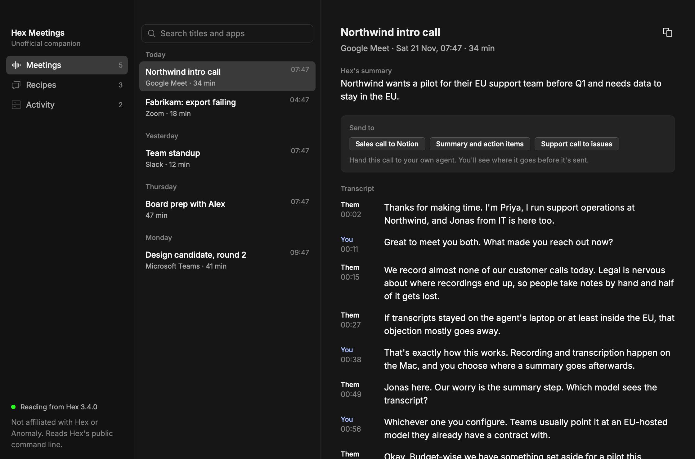
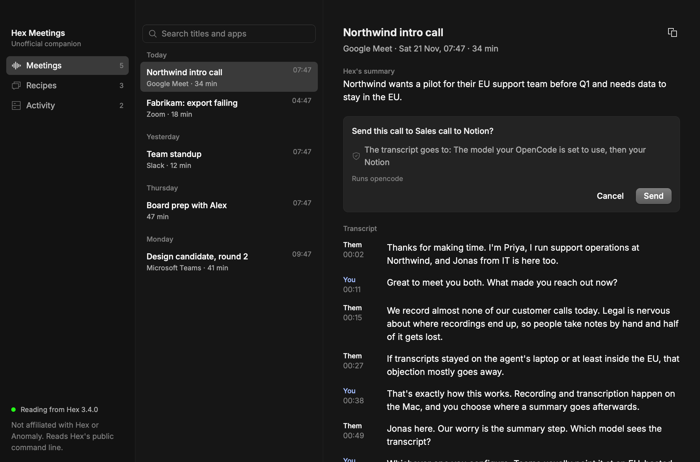
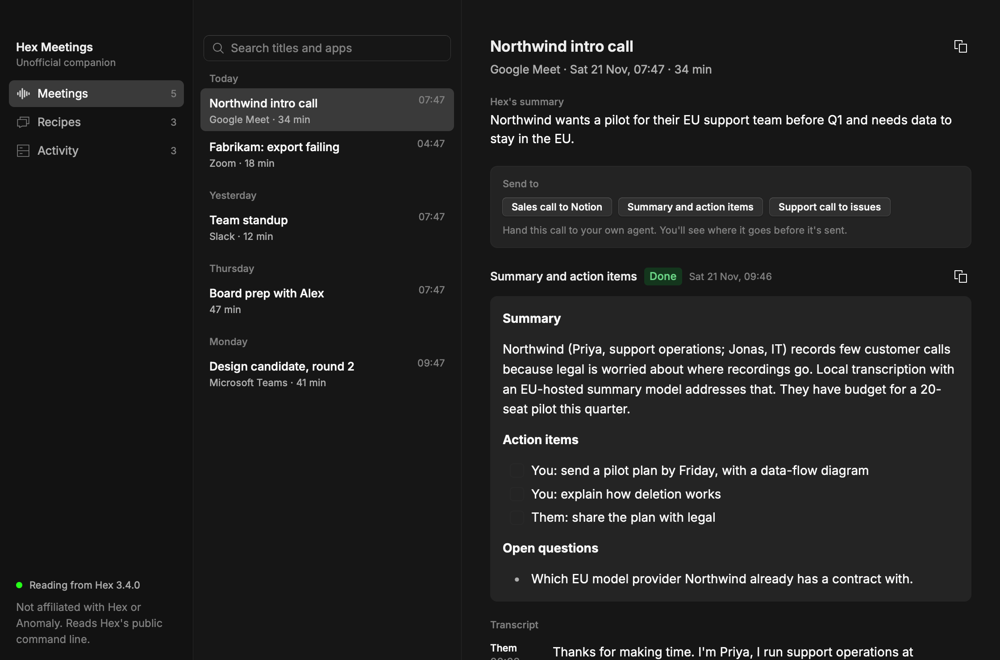

# Hex Meetings

An unofficial companion app for the Meetings beta in [Hex](https://anoma.ly/hex/). It shows the calls Hex recorded, lets you read their transcripts, and hands a transcript to an agent you already use (OpenCode, Claude Code, or any command-line tool) with a recipe you control.

> **Not affiliated with Hex or Anomaly.** This is an independent project. It reads Hex's public, read-only command line and doesn't change Hex or its files.



## Why

Hex records calls and transcribes them on your Mac. Nothing leaves the machine. What happens next is up to you, and Hex leaves that to your agents. This app is the place to do it:

- **Read:** your calls grouped by day, with Hex's summary and the transcript as `You` / `Them` turns.
- **Send:** run a recipe on a call, such as a summary with action items, a sales note in Notion, or support issues in Linear. Before anything runs, the app shows where the transcript is going.
- **Know where it went:** an Activity log on your Mac records which call went to which tool, and what came back.

The app never talks to a model or a cloud service itself. A recipe runs your own tool, and that tool's settings decide the model (local, EU-hosted, whatever you use) and its connections (Notion, Linear, and so on).

| Confirm before sending | The result, beside the transcript |
|---|---|
|  |  |

## Requirements

- Hex 3.4 or later with **Labs › Meetings** turned on (macOS). The app finds `hex` on your PATH or in `/Applications/Hex.app`. Set `HEX_MEETINGS_HEX` to point it elsewhere.
- For recipes: the tool a recipe runs. The shipped recipes use [OpenCode](https://opencode.ai) (`opencode run`).

## Run

```sh
cargo run --release
```

Rune needs the toolchain in `rust-toolchain.toml` (rustup installs it). If Homebrew's `cargo` comes first on your PATH, run `~/.cargo/bin/cargo` instead.

## Recipes

Recipes are Markdown files in `~/Library/Application Support/hex-meetings/recipes/`. The first launch writes three examples. Edit them, delete them, or add your own; **Recipes › Reload** picks up changes.

```markdown
---
name: Summary and action items
description: A short summary, the decisions, and who does what next.
command: opencode run --archived --title "Hex Meetings: {{title}}" {prompt}
sends_to: The model your OpenCode is set to use
---
Summarize this call ...

{{transcript}}
```

- `command` runs directly, never through a shell. `{prompt}` is replaced by the filled-in prompt as one argument; without it, the prompt goes last.
- The prompt and the command can use `{{title}}`, `{{date}}`, `{{duration}}`, `{{app}}`, `{{id}}`, `{{summary}}` (Hex's summary) and `{{transcript}}` (`[mm:ss] You: …` lines).
- `sends_to` is shown before every run. Write it honestly: it's how you tell your future self where the call goes.
- The Notion and issue recipes use `opencode run --auto` so OpenCode can use its tools without a person approving each step. Remove `--auto` if you'd rather not.

Other tools work the same way, for example `command: claude -p {prompt}`, or your own script.

## What it reads, and what it doesn't

- It reads `hex meetings list --json` and `hex meetings show <id> --json`, the [documented JSON contract](https://github.com/anomalyco/hex/blob/dev/docs/transcript-cli.md). Hex documents those commands as never starting the app, opening the microphone, or writing anything.
- It never reads Hex's internal folders, never deletes recordings, and never changes Hex's settings.
- Its own files (recipes and `activity.jsonl`) live in `~/Library/Application Support/hex-meetings/`. Set `HEX_MEETINGS_DIR` to move them.

## Develop

```sh
cargo test                                    # unit tests, plus a contract check against your installed Hex
cargo test -- --ignored summary_recipe        # runs the summary recipe through OpenCode for real
cargo run -- --snap out.png --scene demo      # render a screen headless with made-up data
cargo run -- --list-scenes                    # demo confirm running result recipes activity empty no-hex
HEX_MEETINGS_DEMO=1 cargo run                 # the window with made-up data
```

Built with [Rune](https://github.com/anomalyco/rune), pinned to the revision Hex 3.4 uses. The demo meetings are invented.

## Not yet

- Meetings recorded on an iPhone (send audio to the Mac, transcribe with `hex transcribe`).
- Deleting a call everywhere (Hex's copy, the exported Markdown, the audio).
- Running a recipe automatically when a call ends (Hex's `meeting.finished` event).

## License

MIT
