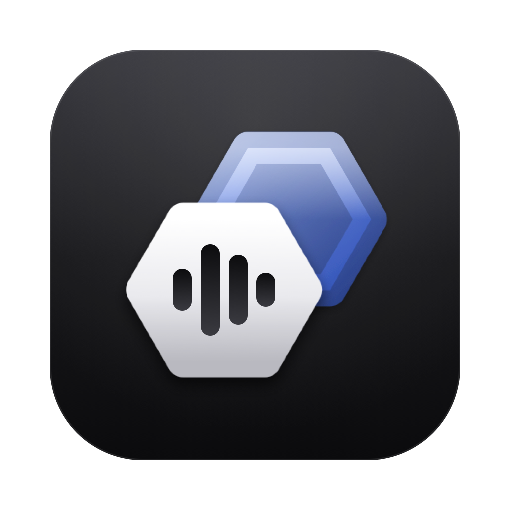

<p align="center"></p>
<h1 align="center">Hex Meetings</h1>
<p align="center">Turn recorded calls into summaries, action items, and follow-ups with the AI agent you already use.</p>
<p align="center">An unofficial macOS companion for <a href="https://anoma.ly/hex/">Hex</a>. Not affiliated with Hex or Anomaly.</p>


## How it works

1. **Record a call in Hex.** Open it in Hex Meetings to read the transcript and Hex's notes.
2. **Run a report.** Start with **Summary**, or write your own instructions for things like sales follow-ups, customer feedback, or bug reports. Use OpenCode, Claude Code, Codex, Cursor Agent, or Pi.
3. **Use the result.** Copy it, save it as Markdown, or preview it before posting to Slack, Notion, GitHub, or Linear.

See the [example reports](examples/reports/) for ideas.

## Get started

You need an **Apple silicon Mac with macOS 15 or later**, **Hex 3.4 or later**, and [Rust installed via rustup](https://rustup.rs/). Hex has a Windows build, but its Meetings recording feature is macOS-only, so this app does not support the Windows meeting workflow.

```sh
git clone https://github.com/OpeOginni/hex-meetings.git
cd hex-meetings
sh scripts/run-macos.sh
```

Follow **Get started** in the app to enable Meetings in Hex and record your first call. To run reports, install one of the supported agent CLIs and select it in **Setup**.

To look around with fictional calls, no Hex or agent needed:

```sh
HEX_MEETINGS_DEMO=1 sh scripts/run-macos.sh
```

## Where your data goes

Hex records and transcribes the call. Hex Meetings reads it through [Hex's public CLI](https://github.com/anomalyco/hex/blob/dev/docs/transcript-cli.md) and doesn't open Hex's internal files.

Before a manual run, the app shows where your transcript will go. Your agent's model settings determine how it processes the transcript. Automatic runs are opt-in and never post on their own. For built-in destinations, the app keeps credentials in the macOS Keychain and asks before posting. If you choose **Your agent's tools**, the agent handles delivery through its own connections.

## Development

```sh
cargo test --locked
cargo run --locked -- --list-scenes
cargo run --locked -- --snap overview.png --scene result --theme dark
```

Built with [Rune](https://github.com/anomalyco/rune). [MIT license](LICENSE). See [asset credits](docs/credits.md).
